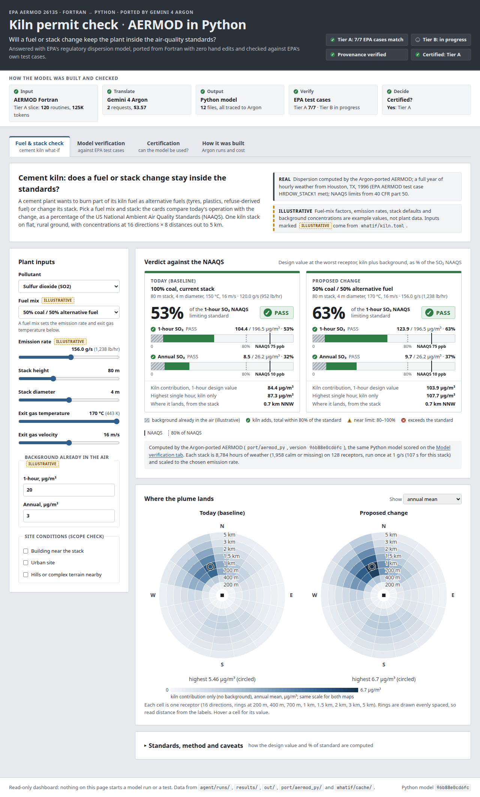
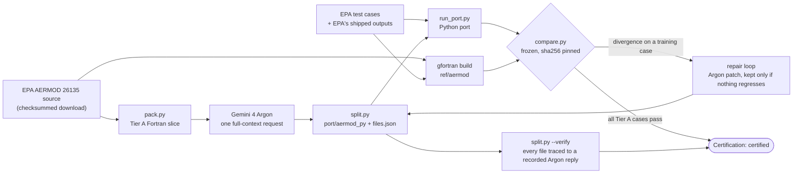
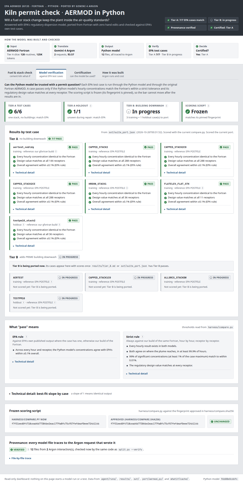
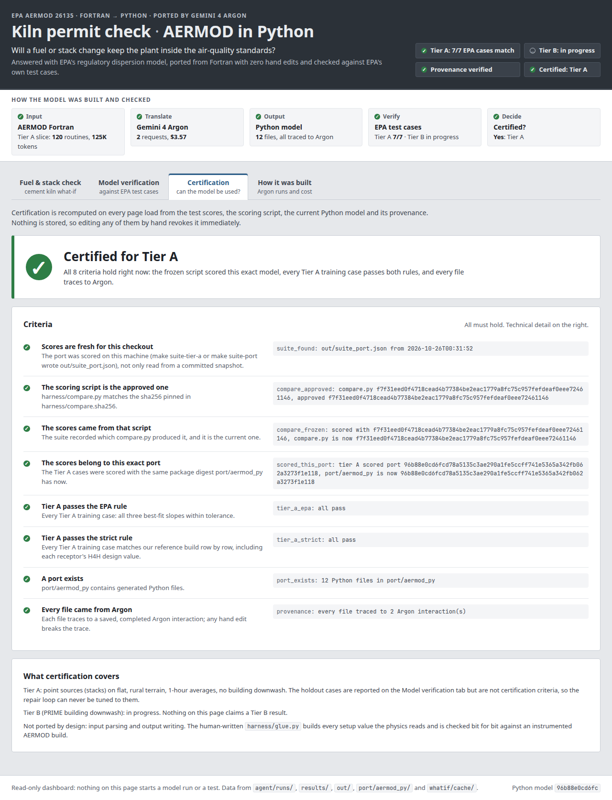
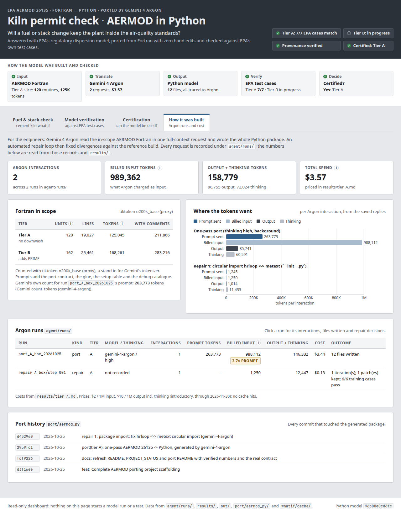

# AERMOD → Python, ported by Gemini 4 Argon

EPA's regulatory air-dispersion model (AERMOD 26135, Fortran) ported to Python by Gemini 4 Argon with **zero hand edits**, and verified against **EPA's own test cases** by a frozen, strict scoring script.



## Why this matters

**AERMOD** is the model the US EPA requires for estimating how pollution from industrial stacks spreads downwind ([40 CFR Part 51, Appendix W](https://www.epa.gov/scram/air-quality-dispersion-modeling-preferred-and-recommended-models)). A permit application for a new or modified plant runs it hour by hour over years of weather and compares the predicted ground-level concentrations with the National Ambient Air Quality Standards (NAAQS). EPA ships it as Fortran source.

Regulatory code like this is hard to modernise because its output carries legal weight: a port has to reproduce the original to the digit, and prove it. This project tests whether a frontier model can do that migration in one pass, with the government's own test suite as the bar and a provenance check that rules out quiet hand-fixes. The author, Siddharth Bellad, is a chemical and process engineer who has worked at cement, lime and steel plants, where this kind of modelling decides whether a fuel switch or a new stack goes ahead; the kiln what-if demo comes from that work.

## Results so far

The block below is generated by `make readme` from `results/tier_*.md`, `agent/runs/`, `context/tokens.json` and `port/aermod_py`. Nothing in it is typed by hand.

<!-- results:begin -->
<!-- generated by `make readme` from results/, agent/runs/, context/ and port/; edit tools/readme_results.py, not this block -->

| Tier | Scope | Training cases passing | Holdout passing | Status |
|---|---|---|---|---|
| A | POINT sources, flat rural terrain, 1-hour, no building downwash | 6/6 | 1/1 | **all pass** |
| B | Tier A plus PRIME building downwash | not yet scored | not yet scored | in progress (not yet published) |

Scores from `results/tier_A.md`, scored 2026-10-25 14:09 PDT on harness f53f81f, with the approved `harness/compare.py`.

| Case | Tests tier | Role | Result | Best-fit slopes (origin / OLS / mean ratio) | Zero/nonzero agreement | p99 relative error | H4H receptors failing |
|---|---|---|---|---|---|---|---|
| `aertest_nobldg` | A | training | PASS | 1.000000/1.000000/1.000000 | 100.000% | 0.00e+00 | 0/144 |
| `CAPPED_STACK2` | A | training | PASS | 1.000000/1.000000/1.000000 | 100.000% | 0.00e+00 | 0/288 |
| `CAPPED_STACK2C0` | A | training | PASS | 1.000000/1.000000/1.000000 | 100.000% | 0.00e+00 | 0/288 |
| `CAPPED_STACK2CE` | A | training | PASS | 1.000000/1.000000/1.000000 | 100.000% | 0.00e+00 | 0/288 |
| `HRDOW_STACK1` | A | training | PASS | 1.000000/1.000000/1.000000 | 100.000% | 0.00e+00 | 0/36 |
| `FLATELEV_FLAT_STK` | A | training | PASS | 1.000000/1.000000/1.000000 | 100.000% | 0.00e+00 | 0/11 |
| `testpm10_stack2` | A | holdout | PASS | 1.000000/1.000000/1.000000 | 100.000% | 0.00e+00 | 0/36 |

| Argon run | Kind | Tier | Model (thinking) | Interactions | Billed input tokens | Output + thinking tokens | Cost |
|---|---|---|---|---|---|---|---|
| `port_A_box_20261025` | port | A | gemini-4-argon (high) | 1 | 988,112 | 146,332 | $3.44 |
| `repair_A_box/step_001` | repair | A | not recorded | 1 | 1,250 | 12,447 | $0.13 |
| **Total** | | | | 2 | 989,362 | 158,779 | **$3.57** |

Costs from `results/tier_A.md`: $2 / 1M input, $10 / 1M output incl. thinking (introductory, through 2026-11-30); no cache hits.

Provenance: 12 Python files in `port/aermod_py`, every one traced to 2 recorded Argon interaction(s) by `split.py --verify`.

| Fortran in scope (tiktoken o200k proxy) | Program units | Lines | Tokens, code only (sent by default) | Tokens with comments |
|---|---|---|---|---|
| Tier A | 120 | 19,027 | 125,045 | 211,866 |
| Tier B | 162 | 25,461 | 168,261 | 283,216 |

<!-- results:end -->

What happened, per `results/tier_A.md`: the one-pass port wrote all 12 files but failed to import because of a circular import. The repair loop sent Argon the traceback; its one patch rewrote `__init__.py` and was kept because nothing regressed. After that every Tier A case passed, including the holdout the repair loop never saw.

## How verification works



**The scoring script is frozen.** `harness/compare.py` decides pass or fail. Its sha256 is pinned in `harness/compare.sha256`; `make check-frozen`, CI and the dashboard all fail if it changes, so the bar cannot be lowered after seeing results.

**A case passes only if both rules hold** (thresholds are constants in `compare.py`):

| Rule | Compared against | Criteria |
|---|---|---|
| EPA rule | EPA's shipped output where the case has one, otherwise our gfortran build | Best-fit slope of port vs reference within 1 ± 0.001. EPA's kit uses "best-fit slope" for three different things, so all three must pass: through the origin (pyaermod), ordinary least squares (EPA's R script), and the ratio of means. |
| Strict rule | Always our gfortran build of the same Fortran | Every output row present in both files; zero/nonzero agreement ≥ 99.9%; 99th-percentile relative error ≤ 1e-4 over values ≥ 1% of the case maximum; every receptor's **H4H** within 1e-4 relative. |

- **Best-fit slope.** Plot every hourly concentration from the port against the reference and fit a line; a perfect port lies on slope 1. 1 ± 0.001 means within 0.1%.
- **H4H ("high fourth-high").** At each receptor, the 4th-highest daily maximum 1-hour concentration in a year: the design value regulators compare with the 1-hour SO2 standard (`pyaermod.design_values`).
- **Holdout.** `testpm10_stack2` and `TESTPM10` are never shown to the repair loop, so passing them is evidence the port generalises rather than being tuned. `testpm10_stack2` needs no downwash and tests Tier A; `TESTPM10` has PRIME building data and tests Tier B.
- **Provenance.** `split.py` writes each file Argon produces into `port/aermod_py` and records its sha256 in `files.json` next to the saved reply. `split.py --verify` re-splits every recorded reply and fails unless each file is byte-identical to one, and that reply's `reply.json` records a completed Argon interaction. `port/aermod_py/README.md` is the only human-owned file there.
- **Certification** (the Certification tab, recomputed on every load): the approved `compare.py` scored *this exact* port version on this machine, every Tier A training case passes both rules, and provenance is clean. Tier B joins the certified scope automatically once every Tier B case passes in the same scoring of the same port; nothing is hard-coded.

## Quickstart

Tested on a fresh clone on Ubuntu 24.04 with Python 3.12 and gfortran 13.3. Prerequisites: `python3` (3.11+) with `venv`, `make`, and `gfortran` for the reference build (`sudo apt install python3-venv gfortran`).

```bash
git clone https://github.com/entersidbellad/argon-aermod.git && cd argon-aermod

make install        # creates .venv and installs requirements.txt; later make targets use .venv automatically
make verify         # provenance: every file in port/aermod_py traced to a recorded Argon interaction
make check-frozen   # compare.py matches its approved sha256
make test-fast      # unit tests; tests that need the EPA download skip with a reason

make demo           # dashboard on http://127.0.0.1:8000 (Ctrl-C to stop)
```

`make demo` alone is enough for a live demo: it installs if needed, runs the provenance check and serves the dashboard from the committed results. It runs offline and loads nothing from a CDN. It opens on the Fuel & stack check. Until you score the port on your machine, the Certification tab says "not yet certified here".

**Reproduce the scores** (downloads about 10 MB from EPA, builds AERMOD with gfortran, then runs the Python port on every Tier A case; the 5-year holdout takes a few minutes):

```bash
make ref            # fetch EPA source + test cases (checksummed), build ref/aermod and ref/aermod_dump
make refs           # run every case through ref/aermod: the oracles in out/ref
make suite-tier-a   # run the port on the Tier A cases + Tier A holdout, score into out/suite_port.json
make demo           # reload: the Certification tab now certifies the port
```

`make suite-port` runs and scores every case, Tier B included. While Tier B is in progress its PRIME cases fail on the Tier A port, so that target exits non-zero; the dashboard labels those cases "in progress". For the full test suite: `make dumps debug-refs && make test`.

**Re-run Argon** (needs `GEMINI_API_KEY`; costs real money, see "Cost controls"):

```bash
python agent/port.py --tier A --dry-run      # writes the prompt and counts tokens, no API call
python agent/port.py --tier A                # one pass; reply saved under agent/runs/
python agent/repair_loop.py --tier A         # repair against the tier's training cases
make readme                                  # refresh the results block above
```

## The dashboard

`make demo` (or `python server.py --root OTHER_CHECKOUT` to read another checkout's runs and results). Read-only: every number is computed from files on disk at page load, and nothing on the page starts a model run.

| Tab | Shows | Read from |
|---|---|---|
| Fuel & stack check | The cement-kiln what-if below: a verdict card per scenario (% of the NAAQS, pass / near limit / exceeds), gauges against the standard line, the plume footprint | `whatif/kiln.toml`, `whatif/cache/` |
| Model verification | Per EPA test case, in plain terms (hourly concentrations within the strict tolerance, design value matching at every receptor, "identical" only when the largest difference is exactly 0), with slope, p99 and H4H one click down under "Technical detail"; the frozen digest; every file's provenance | `out/suite_port.json`, else `results/tier_*.md`; `harness/compare.py`; `split.trace` |
| Certification | Certified or not, for which tiers, with each criterion and why | all of the above, recomputed |
| How it was built | Argon requests, tokens and cost per run; Fortran in scope; files each reply wrote; repair decisions; git history of the port | `agent/runs/`, `results/tier_*.md`, `context/tokens.json` |

The look follows ISA-101 high-performance HMI practice: neutral greys, one steel blue for controls, and colour only for status. Green means within the limit or pass, amber means at or above 80% of the standard (a screening margin chosen for this dashboard, not a regulatory threshold), and red means exceeds or fails. Every status colour comes with an icon and a text label, so nothing depends on colour alone. Emission rates show g/s and lb/hr.

Tier B shows "in progress" until every Tier B case passes in `results/tier_B.md` or `out/suite_port.json`; it is never shown as a result before then.

| Model verification | Certification | How it was built |
|---|---|---|
|  |  |  |

## Kiln what-if demo

A cement plant wants to burn part of its kiln fuel as alternative fuels (tyres, plastics, refuse-derived fuel) or change its stack. Will the air around the plant still meet the NAAQS for SO2 and NO2?

- **Real:** the dispersion, computed by the Argon-ported AERMOD (`port/aermod_py`) for every stack in the grid at 1 g/s and cached in `whatif/cache/` with the port's sha256; a full year of met from the Tier A EPA case HRDOW_STACK1; the NAAQS values and forms from 40 CFR part 50. The statistics match `ref/aermod`'s own outputs on the same deck (`tests/test_whatif.py`).
- **Illustrative:** stack defaults, fuel-mix emission factors, emission rates and background concentrations. All are invented example values in one editable file, `whatif/kiln.toml`.
- **Guardrail:** a building near the stack, an urban site or complex terrain is outside what the demo precomputes (one stack, flat rural terrain, no buildings), so the card shows "outside scope" instead of a number.
- `make whatif` recomputes the cache by running every stack through the port (slow; only needed after changing the grid or the port).

## Limitations and scope

- **Tier A** (certified): POINT sources, FLAT terrain, rural, concentration, 1-hour averages, no building downwash.
- **Tier B** (in progress): adds PRIME building downwash. Being ported now; no Tier B result is claimed until the results block above says so.
- **Not ported, by design:** input parsing (SETUP) and output writing. The human-written `harness/glue.py` parses the deck with pyaermod and builds every SETUP value the physics reads; it is checked bit for bit against `SETUP.DMP` from an instrumented AERMOD build and round-trips AERMOD's POSTFILE byte for byte.
- **Reference:** EPA's kit states no numeric slope threshold; 0.001 is pyaermod's default. Our gfortran build differs slightly from EPA's shipped files on two cases, which is why the strict rule always compares against our own build.
- **Argon calls** ran on another machine; this repository holds the recorded replies, which is what `split.py --verify` checks. Token counts for the Fortran slice use a proxy tokenizer (tiktoken o200k), not Gemini's.
- **Kiln demo:** one year of met where the NAAQS forms average three; 128 receptors where a permit study would use a dense grid; NOx compared as NO2 with full conversion; stacks limited to the precomputed grid. It is a demonstration, not a permit analysis.

More detail on what is and is not verified: [`PROJECT_STATUS.md`](PROJECT_STATUS.md).

## Repo map

| Path | What it is |
|---|---|
| `port/aermod_py/` | The Python port. Argon output only, plus a human README with the contract |
| `agent/` | `argon.py` (Interactions API client), `port.py` (one-pass port), `repair_loop.py`, `baselines/chunked.py` |
| `agent/runs/` | Every recorded Argon interaction: prompt metadata, reply, `files.json` (provenance), repair decisions |
| `results/` | Committed result snapshots per tier: case table, Argon calls and costs |
| `harness/` | `compare.py` (frozen scorer), `glue.py`, `run_port.py`, `run_ref.py`, `suite.py`, `debugdiff.py`, `fuzz.py`, ... |
| `cases/` | The reduced EPA decks per case (committed); met and EPA outputs come from `ref/fetch.py` |
| `ref/` | `fetch.py` (checksummed EPA download), `build.sh` and `build_dump.sh` (gfortran builds) |
| `prompts/` | Port contract, port, repair and consult prompts, DEBUGOPT variable catalogue |
| `split.py` | Splits Argon replies into `port/aermod_py`; `--verify` checks provenance |
| `pack.py` | Packs the in-scope Fortran into `context/` and counts tokens |
| `server.py`, `ui/` | The read-only dashboard (FastAPI + one static page, no external assets) |
| `whatif/` | Kiln demo: `kiln.toml` (config), `scenario.py`, `precompute.py`, `cache/` |
| `tools/` | `readme_results.py` (this README's results block), `screenshots.py` (`docs/screenshots/`) |
| `tests/` | pytest; `stub_ports/` hold replay, zero and buggy fake ports |

## Under the hood

**Port contract** (`prompts/contract.md`): `run_case(project, met, setup, *, debug=False) -> glue.Result` with `conc[hour, receptor]`. With `debug=True` the port also returns rows named after AERMOD's DEBUGOPT output; `harness/debugdiff.py` finds the first divergent record against the reference.

**Repair loop** (`agent/repair_loop.py`):
1. Score the training cases and find the first problem: a crash, or the first divergent DEBUGOPT record.
2. Send Argon that record, the met for that hour, the Fortran unit and the Python files translating it.
3. A patch may touch at most 2 files. It is kept only if nothing regresses and the target passes or its first problem moves later; otherwise it is reverted.
4. After 3 rejections on the same target, escalate to a full-context consult.

**Cost controls:**
- `agent/port.py` sends the comment-stripped Fortran (`context/tier_<T>_code.txt`) unless you pass `--with-comments`.
- Argon decodes long replies in 64K-token hops and every hop bills the full input again, which is why the port run billed several times its prompt. `port.py` warns when `--max-output-tokens` is above 65,536 and records `expected_input_multiplier` in `run.json`.
- `repair_loop.py --budget-usd` stops before a request would pass the cap (needs `--usd-per-mtok-input`/`--usd-per-mtok-output`); `--stop-at-passing N` stops once N training cases pass; every repair packet must fit within 30K tokens.

## License

MIT, © 2026 Siddharth Bellad. AERMOD itself is US EPA software; `ref/fetch.py` downloads it from EPA SCRAM.
